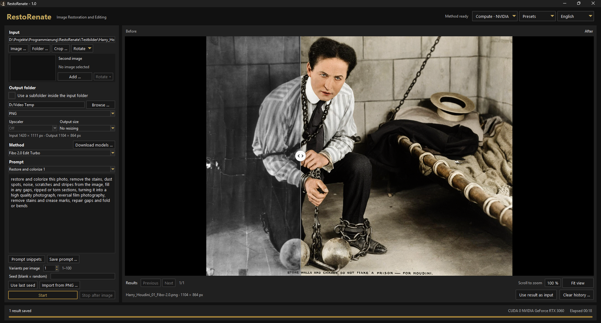

# RestoRenate 1.3

[Downloads and SHA-256 (1.2)](https://github.com/muelli1975/RestoRenate/releases/tag/v1.2) · [Deutsch](README_DE.md) · [User guide](docs/portable/README_EN.md)

RestoRenate is a local desktop tool for restoring, colorizing and upscaling photos. With text prompts and supported models, it can also edit an image or use a second photo as a reference. The interface is available in English and German.

The app asks before downloading missing models and the processing runtime. Image processing runs locally and offline after setup. **Download models …** can fetch additional files in the background while you work with ready-to-use methods.

## Before and after

Restored and colorized with Fibo 2.0 Edit Turbo. Original photograph from the Library of Congress, McManus-Young Collection, credited to Famous Players–Lasky Corporation. [Image source and rights information](https://commons.wikimedia.org/wiki/File:Harry_Houdini.jpg)

## Requirements and installation

| Platform | Package and requirements |
| --- | --- |
| Windows x64 | Extract the portable ZIP to a short, writable path such as `D:\RestoRenate` and open `RestoRenate.exe`. Python and ExifTool are included. |
| macOS 15 or newer, Apple Silicon | Portable release. Extract the ZIP to a writable folder and open `RestoRenate.app` from that folder. |
| Ubuntu 24.04 x86-64 | Portable release. Extract the `.tar.gz` to a writable folder and run `./Start.sh` in a graphical desktop session. |

The Linux and macOS packages include Python, Tk and ExifTool. ExifTool uses the system Perl. The app downloads the selected models and processing libraries into the program folder when needed. [Linux builds](https://github.com/muelli1975/RestoRenate/actions/workflows/linux.yml) · [macOS builds](https://github.com/muelli1975/RestoRenate/actions/workflows/macos.yml)

Windows offers CPU and NVIDIA modes, plus experimental AMD ROCm. The Linux release defaults to CPU and offers experimental modes for NVIDIA (CUDA 13-compatible driver) and AMD ([hardware and drivers compatible with ROCm 7.2](https://rocm.docs.amd.com/projects/radeon-ryzen/en/docs-7.2/docs/compatibility/compatibilityrad/native_linux/native_linux_compatibility.html)). The macOS release defaults to Apple Metal (MPS) and also offers CPU processing. Nunchaku INT4 is available on supported Windows NVIDIA systems.

When updating Windows, close RestoRenate and extract the package into a clean folder. To keep an existing setup, copy `models`, `backend`, `downloads`, `settings` and the existing runtime subfolders and download receipts as needed. Extract the new package in full to keep its `_internal`, `assets` and `tools` together.

## Quick start

1. Open a photo or folder. Crop or rotate the input if needed.
2. Check the output destination, choose a file format and size, then select a method. Edit the prompt for models that accept text.
3. Select **Start**. Use **Download models …** to prepare multiple methods in one pass. Optional Lightning LoRAs are listed beneath their base models.
4. Compare the saved result with the before-and-after slider. The navigation shows **Result 1/3**, for example. Use **Ctrl+1** for 100%, **Esc** to fit the view, and **Page Up / Page Down** to browse results.

## New in 1.3

Upscalers are grouped by use. Nomos2 HQ DAT2 and Nomos8kDAT join the photo models. SeedVR2 3B INT8 and VOSR 2.0 reconstruct detail in a single step. All four can upscale a photo directly or process the result of a restoration.

## New in 1.2

**FLUX 3 Image Klein · INT8** edits photos in 16 steps with a local prompt upsampler and can use a second photo. It is available in GPU modes. The optional download uses the KoalaNation mirror without a Hugging Face account. RestoRenate checks the weights against the original SHA-256 hashes and reuses Fibo's text encoder and the shared FLUX VAE. The FLUX Kommunity License applies.

Microsoft can colorize restored photos in the same run. CPU and GPU modes remember their method and scaling settings separately. The CPU default is Microsoft with no resizing. The model download dialog verifies existing files in the background when verification receipts are missing.

## New in 1.1

Crop and rotate the second reference independently. The primary image and its crop determine the output aspect ratio. The prompt menu adds two compositing presets and reusable edit instructions.

Choose from 50 StereoFine LUTs. Use **C** to inspect the look on the right. Hold **C** while pressing the left or right arrow to choose a look, or the up or down arrow to change the strength. Enable **Apply LUT** to include the look in the next model run. **Create LUT variant** exports the selected input or result as a new numbered file without running a model. Press **F1** for controls.

JPEG and TIFF retain compatible original EXIF and store RestoRenate settings in XMP. PNG uses ComfyUI's prompt and workflow metadata. LUTs and the optional colorization after Microsoft restoration run outside the embedded workflow. For the bundled LUTs, see [sources and licenses](assets/luts/CREDITS.md).

## Models and output

By default, results go into `output` next to the selected image or inside the selected input folder. Choosing a new input updates the destination. **Browse …** switches to a custom folder and saves results directly there. The app remembers the mode and the custom path separately.

- **Restoration and editing:** Microsoft Bringing Old Photos Back to Life, Fibo 2.0 Edit Turbo, FLUX.2 [klein] 4B, FLUX 3 Image Klein, Qwen Image Edit 2509/2511 and FireRed Image Edit 1.1. Some edit models support a separately rotatable second input.
- **Colorization:** DDColor ModelScope, Paper, Artistic and Tiny, plus DeOldify Stable and Artistic. Colorization runs on the CPU. DDColor Paper is an optional model download.
- **Upscaling:** SeedVR2 3B INT8 is the GPU default. The selection also includes VOSR 2.0, Nomos2 HQ MoSR, Nomos2 HQ DAT2, Nomos8kDAT, Lanczos, UltraSharp V2 Lite, Real-ESRGAN, FaceUpDAT for portraits, and Real-ESRGAN Anime 4× and AnimeSharp 4× for drawings and illustrations.
- **Export:** PNG, JPEG quality 95 with 4:4:4 chroma and TIFF with LZW compression. JPEG and TIFF copy compatible source metadata. PNG stores a ComfyUI workflow when applicable.

## Source and builds

The source includes the desktop app, download manifests and ComfyUI adapters. [GitHub Actions](https://github.com/muelli1975/RestoRenate/actions) records builds and tests. The portable Windows release includes its launcher, Python environment and export tools.

## License

RestoRenate's own code uses the [MIT License](LICENSE). See [THIRD_PARTY.txt](THIRD_PARTY.txt) for component and model licenses.
