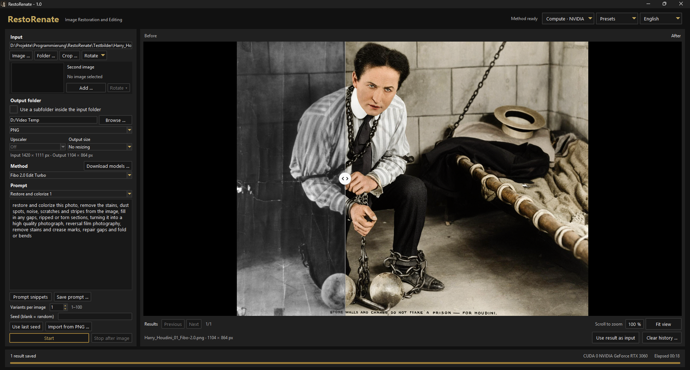

# RestoRenate 1.3

[Downloads und SHA-256](https://github.com/muelli1975/RestoRenate/releases/latest) · [English](README.md) · [Anleitung](docs/portable/README_DE.md)

RestoRenate restauriert, koloriert und vergrößert Fotos lokal auf dem Rechner. Mit unterstützten Modellen lassen sich Bilder auch per Prompt bearbeiten oder anhand eines zweiten Fotos verändern. Die Oberfläche ist auf Deutsch und Englisch verfügbar.

Die App fragt vor dem Download fehlender Modelle und Laufzeitdateien nach. Nach der Einrichtung läuft die Bildbearbeitung lokal und offline. Über **Modelle vorab laden …** lassen sich weitere Dateien im Hintergrund laden. Einsatzbereite Verfahren stehen dabei weiter zur Verfügung.

## Vorher und nachher

Restauriert und koloriert mit Fibo 2.0 Edit Turbo. Originalfoto aus der McManus-Young-Sammlung der Library of Congress, zugeschrieben der Famous Players–Lasky Corporation. [Bildquelle und Rechtehinweis](https://commons.wikimedia.org/wiki/File:Harry_Houdini.jpg)

## Voraussetzungen und Start

| Plattform | Paket und Voraussetzungen |
| --- | --- |
| Windows x64 | Die portable ZIP in einen kurzen, beschreibbaren Pfad wie `D:\RestoRenate` entpacken und `RestoRenate.exe` öffnen. Python und ExifTool sind enthalten. |
| macOS 15 oder neuer, Apple Silicon | Portable Ausgabe. Die ZIP in einen beschreibbaren Ordner entpacken und `RestoRenate.app` aus diesem Ordner öffnen. |
| Ubuntu 24.04 x86-64 | Portable Ausgabe. Das `.tar.gz` in einen beschreibbaren Ordner entpacken und `./Start.sh` in einer grafischen Sitzung starten. |

Die Pakete für Linux und macOS enthalten Python, Tk und ExifTool. ExifTool verwendet das Perl des Systems. RestoRenate lädt ausgewählte Modelle und Rechenbibliotheken bei Bedarf in den Programmordner. [Linux-Builds](https://github.com/muelli1975/RestoRenate/actions/workflows/linux.yml) · [macOS-Builds](https://github.com/muelli1975/RestoRenate/actions/workflows/macos.yml)

Unter Windows stehen CPU und NVIDIA sowie AMD ROCm als experimentelle Option zur Wahl. Die Linux-Ausgabe startet standardmäßig auf der CPU und bietet experimentelle Modi für NVIDIA (CUDA-13-tauglicher Treiber) und AMD ([mit ROCm 7.2 kompatible Hardware und Treiber](https://rocm.docs.amd.com/projects/radeon-ryzen/en/docs-7.2/docs/compatibility/compatibilityrad/native_linux/native_linux_compatibility.html)). Die macOS-Ausgabe verwendet standardmäßig Apple Metal (MPS) und bietet auch CPU-Berechnung. Nunchaku INT4 ist auf unterstützten NVIDIA-Systemen unter Windows verfügbar.

Für ein Windows-Update RestoRenate schließen und das neue Paket in einen sauberen Ordner entpacken. Zur Übernahme der Einstellungen die Datei `settings.json` direkt in den neuen Programmordner kopieren. `models`, `backend`, `downloads` sowie die benötigten Laufzeit-Unterordner und Download-Prüfbelege können bei Bedarf übernommen werden. `_internal`, `assets` und `tools` gehören zum neuen Paket.

## Schnellstart

1. Ein Foto oder einen Ordner öffnen. Die Eingabe bei Bedarf beschneiden oder drehen.
2. Ausgabeziel prüfen, Format und Größe wählen, dann ein Verfahren auswählen. Bei Modellen mit Texteingabe den Prompt bearbeiten.
3. **Start** wählen. Über **Modelle vorab laden …** lassen sich mehrere Verfahren gemeinsam einrichten. Optionale Lightning-LoRAs stehen unter ihrem Basismodell.
4. Das gespeicherte Ergebnis mit dem Vorher-Nachher-Regler vergleichen. Die Navigation zeigt beispielsweise **Ergebnis 1/3**. **Strg+1** zeigt 100 %, **Esc** passt die Ansicht ein. **Bild↑ / Bild↓** blättern durch die Ergebnisse.

## Neu in 1.3

Die Upscaler sind nach Einsatzbereich gruppiert. Nomos2 HQ DAT2 und Nomos8kDAT ergänzen die Fotomodelle. SeedVR2 3B INT8 und VOSR 2.0 rekonstruieren Details in einem Verarbeitungsschritt. Alle vier können ein Foto direkt vergrößern oder das Ergebnis einer Restaurierung weiterverarbeiten.

## Neu in 1.2

**FLUX 3 Image Klein · INT8** bearbeitet Fotos in 16 Schritten mit einem lokalen Prompt-Umschreiber und unterstützt Bild 2. Das Modell steht in den GPU-Modi zur Auswahl. Der optionale Download vom KoalaNation-Spiegel funktioniert ohne Hugging-Face-Konto. RestoRenate prüft die SHA-256-Werte der Originaldateien und verwendet Fibos Textencoder sowie den gemeinsamen FLUX-Bilddecoder weiter. Es gilt die FLUX Kommunity License.

Microsoft kann restaurierte Fotos im selben Durchlauf kolorieren. CPU und GPU merken sich ihre Verfahrens- und Skalierungseinstellungen getrennt. Im CPU-Modus ist Microsoft ohne Nachskalierung voreingestellt. Die Modellübersicht prüft vorhandene Dateien im Hintergrund, wenn Prüfbelege fehlen.

## Neu in 1.1

Bild 2 kann unabhängig beschnitten und gedreht werden. Bild 1 bestimmt mit seinem Ausschnitt das Seitenverhältnis der Ausgabe. Zwei Montage-Presets und zusätzliche Satzbausteine stehen im Prompt-Menü bereit.

50 StereoFine-LUTs stehen zur Auswahl. **C** zeigt den Look rechts an, **C** mit Links/Rechts wählt den Look und **C** mit Hoch/Runter ändert seine Stärke. **LUT anwenden** nimmt den Look in den nächsten Modelllauf auf. **Variante mit LUT erstellen** speichert die gewählte Eingabe oder das Ergebnis als neue Datei mit Folgenummer. **F1** öffnet die Bedienhilfe.

JPEG und TIFF übernehmen geeignete Original-EXIF-Daten und speichern die RestoRenate-Einstellungen in XMP. PNG verwendet die Prompt- und Workflow-Metadaten von ComfyUI. LUTs und die zusätzliche Kolorierung nach Microsoft laufen außerhalb des eingebetteten Workflows. Die mitgelieferten LUTs sind in den [Quellen und Lizenzen](assets/luts/CREDITS.md) dokumentiert.

## Modelle und Ausgabe

Standardmäßig landen die Ergebnisse in `output` neben dem gewählten Bild oder im gewählten Eingabeordner. Mit jeder neuen Eingabe passt sich das Ziel an. **Auswählen …** wechselt zu einem eigenen Ordner und speichert direkt dort. Die App merkt sich den Ausgabemodus und den eigenen Ordner getrennt.

- **Restaurierung und Bearbeitung:** Microsoft Bringing Old Photos Back to Life, Fibo 2.0 Edit Turbo, FLUX.2 [klein] 4B, FLUX 3 Image Klein, Qwen Image Edit 2509/2511 und FireRed Image Edit 1.1. Unterstützte Edit-Modelle können ein separat drehbares zweites Bild nutzen.
- **Kolorierung:** DDColor ModelScope, Paper, Artistic und Tiny sowie DeOldify Stable und Artistic. Die Kolorierung läuft auf der CPU. DDColor Paper ist ein optionaler Download.
- **Hochskalieren:** Das GPU-Preset „Standard“ verwendet ClearRealityV1 SPAN 4×. Das Preset „Detailrekonstruktion“ verwendet VOSR 2.0. Zur Auswahl stehen auch SeedVR2 3B INT8, Nomos2 HQ DAT2, Nomos8kDAT, Lanczos, UltraSharp V2 Lite, Real-ESRGAN, FaceUpDAT für Porträts sowie Real-ESRGAN Anime 4× und AnimeSharp 4× für Zeichnungen und Illustrationen.
- **Export:** PNG, JPEG mit Qualität 95 und 4:4:4 sowie TIFF mit LZW-Kompression. JPEG und TIFF übernehmen geeignete Metadaten. PNG speichert bei ComfyUI-Verarbeitung den Workflow.

## Quellcode und Builds

Der Quellcode enthält die Anwendung, Downloadlisten und ComfyUI-Adapter. Die Builds und Tests stehen unter [GitHub Actions](https://github.com/muelli1975/RestoRenate/actions). Das portable Windows-Paket enthält den Starter, die Python-Umgebung und die Exportwerkzeuge.

## Lizenz

RestoRenates eigener Code steht unter der [MIT-Lizenz](LICENSE). Die Lizenzen für Fremdkomponenten und Modelle stehen in [THIRD_PARTY.txt](THIRD_PARTY.txt).
